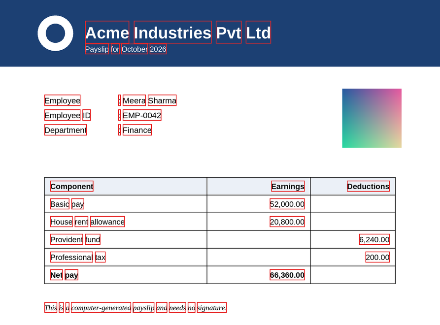

# pdfsieve

**Read words, characters, lines, shapes and images from PDF pages, with exact coordinates.**
Pure Python, Apache-2.0 licensed, built on [pdfminer.six](https://github.com/pdfminer/pdfminer.six).

```python
import pdfsieve

with pdfsieve.open("payslip.pdf") as doc:
    for w in doc.page(0).words():
        print(f"{w.x0:6.1f} {w.y0:6.1f}  {w.text}")
```



## Why pdfsieve

- **Coordinates you can use directly.** Everything is in PDF points with the origin at the
  **top-left** of the visible page, y pointing down, with the page's rotation and crop already
  applied. A box scales straight onto a rendered image: multiply by your zoom and draw.
- **Words that match what a viewer shows.** Characters are joined into words with rules tuned on
  real payslips, invoices and bank statements: justified text, tight table cells, fake-bold text
  (letters printed twice), ligatures (`fi` → `fi`), and sideways text.
- **More than text.** Table borders as straight segments, filled and stroked shapes with their
  colours, embedded images with their placement, fonts, and per-page signals that tell a digital
  page from a scan or from text drawn as outlines.
- **No native code.** Only pure-Python dependencies, so it installs and runs where policies block
  native PDF DLLs (Windows Application Control, locked-down servers, restricted sandboxes).
- **Permissive licence.** Apache-2.0, on top of MIT-licensed pdfminer.six. Use it in commercial,
  closed-source products.

Need a picture of the page too, for OCR or for drawing boxes on screen? See the companion
package **[pdfpainter](https://github.com/Vibhu1712/pdfpainter)**, which paints
pdfsieve pages with Pillow alone.

## Contents

- [Install](#install)
- [Quick start](#quick-start)
- [Command line](#command-line)
- [Coordinates](#coordinates)
- [API reference](#api-reference)
- [Recipes](#recipes)
- [How words are formed](#how-words-are-formed)
- [Accuracy and speed](#accuracy-and-speed)
- [Limitations](#limitations)
- [How it compares](#how-it-compares)
- [Development](#development)
- [Licence](#licence)

## Install

```bash
pip install pdfsieve
```

Python 3.9 or newer. The only dependency is `pdfminer.six`.

## Quick start

```python
import pdfsieve

with pdfsieve.open("invoice.pdf") as doc:          # a path, the PDF's bytes, or a binary file
    print(doc.page_count, doc.metadata().get("title"))

    page = doc.page(0)                              # 0-based; doc[-1] is the last page
    print(page.width, page.height)                  # points, after rotation

    print(page.text())                              # plain text, line by line

    for w in page.words():                          # Word(x0, y0, x1, y1, text)
        print(w.text, w.x0, w.y0, w.x1, w.y1)

    for line in page.lines():                       # words grouped into lines
        print(" | ".join(w.text for w in line))

    for seg in page.vertical_lines():               # table borders: Segment(x, top, bottom)
        print("vertical rule at x =", seg.pos)

    for pic in page.pictures:                       # embedded images
        print("image at", pic.bbox)
```

Iterate over all pages with `for page in doc:`. Pages are read when first asked for and then
remembered; call `doc.forget()` to free memory on very long documents.

## Command line

Installing the package adds a `pdfsieve` command (also `python -m pdfsieve`):

```bash
pdfsieve payslip.pdf                     # plain text of every page (pages separated by form feeds)
pdfsieve payslip.pdf -p 1,3-5            # only some pages (1-based)
pdfsieve payslip.pdf -f words            # page, x0, y0, x1, y1, text, tab-separated
pdfsieve payslip.pdf -f json > out.json  # lines of words with boxes, plus page facts
pdfsieve payslip.pdf -f info             # page sizes, word/image/shape/curve counts, fonts
pdfsieve scan.pdf --visible-only         # ignore a scan's hidden OCR layer
pdfsieve locked.pdf --password secret
```

`-f info` is a quick way to see why a page has no text:

```
File:      sample.pdf
Pages:     1   encrypted: False
Title:     Sample payslip
Producer:  ReportLab PDF Library - (opensource)
Page 1: 595.3 x 841.9 pt, rotate 0, 53 words, 1 images, 14 shapes, 8 curves, 3 fonts
```

## Coordinates

```
(0, 0) ──────────────── x ──────────────▶ (width, 0)
  │
  │   ┌─────────────┐
  │   │ (x0, y0)    │   a word's box: x0 < x1, y0 < y1
  y   │      (x1, y1)
  │   └─────────────┘
  ▼
(0, height)
```

- Units are PDF points: 1/72 inch. Multiply by `zoom` (pixels per point) to land on a rendered
  image; at 150 dpi, `zoom = 150 / 72`.
- The origin is the top-left of the **CropBox** (the part of the page viewers show).
- A page's `/Rotate` is already applied: `page.width` and `page.height` are the size you see, and
  text on a rotated page comes out with `Glyph.turn` set accordingly.
- Word boxes span the font's ascent and descent, as other engines report them, so boxes on one line
  share their top and bottom even for words without tall letters.

## API reference

### Opening

| | |
|---|---|
| `pdfsieve.open(source, password="")` | Open a PDF. `source` is a path, `bytes`, or a binary file object. Returns a `Document`. |
| `pdfsieve.Document(source, password="")` | Same as `open`. |

Errors: `PasswordError` (also a `PermissionError`) when a password is needed or wrong,
`EmptyDocumentError` (also a `ValueError`) for a PDF with no pages, `PdfSieveError` (the base
class) for anything that isn't a readable PDF. A missing file raises the usual `FileNotFoundError`.

### `Document`

| Member | Meaning |
|---|---|
| `page_count`, `len(doc)` | Number of pages. |
| `page(i)`, `doc[i]` | The `Page` at 0-based index `i` (negative counts from the end). |
| `for page in doc` | Every page in order. |
| `size(i)` | `(width, height)` of a page without reading its content. |
| `metadata()` | Info dictionary with lower-case keys: `title`, `author`, `producer`, `creator`, ... |
| `encrypted` | True when the file was encrypted (and opened). |
| `errors` | `{page index: message}` for damaged pages. What was read before the fault is kept. |
| `forget(i=None)` | Drop remembered content of one page, or all pages. |
| `close()`, `with ...` | Close the file. A file object you passed in is left open. |

### `Page`

| Member | Meaning |
|---|---|
| `index` | 0-based page number. |
| `width`, `height` | Visible size in points, after rotation. |
| `rotation` | The page's `/Rotate`: 0, 90, 180 or 270 (already applied). |
| `words(visible_only=False)` | List of `Word`, line by line. `visible_only` skips invisible text such as a scan's OCR layer. |
| `lines(visible_only=False)` | List of lines, each a list of `Word`. |
| `text(visible_only=False)` | Plain text: words joined by spaces, lines by newlines. |
| `vertical_lines(min_len=4)` | `Segment(x, top, bottom)` for vertical strokes and rectangle edges. |
| `horizontal_lines(min_len=4)` | `Segment(y, left, right)` for horizontal strokes and rectangle edges. |
| `glyphs` | Every character as a `Glyph`, in drawing order. |
| `items` | `Shape` and `Picture` objects in drawing order. |
| `shapes`, `pictures` | Only the shapes, or only the pictures. |
| `fonts` | Set of font names used on the page. |
| `images` | Number of images drawn. |
| `curves` | Number of Bézier curve segments. Hundreds with no text usually means text drawn as outlines. |
| `undefined` | Characters with no Unicode mapping (they appear as `"�"`). |

### Data types

**`Word(x0, y0, x1, y1, text)`**, a `NamedTuple`, so `x0, y0, x1, y1, text = word` works. Extra
properties: `cx`, `cy` (centre), `width`, `height`.

**`Glyph`**, one character:

| Field | Meaning |
|---|---|
| `x0, y0, x1, y1` | Box in page space. |
| `text` | The character (ligatures stay as one character here). |
| `size` | Font size on the page, in points. |
| `font` | PDF font name, e.g. `ABCDEF+Arial-BoldMT`. |
| `color` | Fill colour `(r, g, b)` 0–255, or `None` when it can't be known. |
| `visible` | False for invisible text (render modes 3 and 7). |
| `upright`, `turn` | Writing direction: `turn` is 0, 90 (reads upwards), 180, or 270 (reads downwards). |
| `base` | Baseline y. |
| `run` | Which text-showing operation drew it. Characters of one table cell usually share a run. |

**`Shape`**, one painted path: `subpaths` (a list of `(points, closed)`, where points are
`("m", x, y)`, `("l", x, y)` and `("c", x1, y1, x2, y2, x3, y3)`), `fill` and `stroke` colours
(`None` when not filled or stroked), `width` (stroke width on the page), and `evenodd` (fill rule).

**`Picture`**, one embedded image: `stream` (the pdfminer stream with the image data), `matrix`
(maps the image's unit square onto the page), `bbox` (its box on the page), and `color` (the paint
colour of 1-bit stencil masks).

**`Segment(pos, a0, a1)`**: `pos` is x for vertical segments and y for horizontal ones; `a0` and
`a1` are the start and end along the segment; `length` is `a1 - a0`.

### Lower-level functions

| Function | Meaning |
|---|---|
| `words_from(glyphs)` | Join any list of `Glyph` into `Word`s, e.g. only the glyphs inside a region. |
| `lines_from(glyphs)` | The same, grouped into lines. |
| `vertical_segments(page, min_len)`, `horizontal_segments(page, min_len)` | Same as the `Page` methods. |
| `to_rgb(color, colorspace)` | Convert a PDF colour to `(r, g, b)`. |
| `Recorder` | The pdfminer device that does the recording, for building your own pipeline. |

## Recipes

Runnable versions live in [`examples/`](examples). Make the sample PDF they use with
`python examples/make_sample_pdf.py` (needs `pip install reportlab`).

### Words inside a region

```python
def words_in(page, box):
    x0, y0, x1, y1 = box
    return [w for w in page.words() if x0 <= w.cx <= x1 and y0 <= w.cy <= y1]

net_pay_row = words_in(page, (60, 360, 535, 384))   # "Net pay 66,360.00" in the sample
```

### The value to the right of a label

```python
def value_after(page, label):
    words = page.words()
    for i, w in enumerate(words):
        if w.text == label:
            right = [v for v in words if abs(v.cy - w.cy) < w.height / 2 and v.x0 > w.x1]
            return " ".join(v.text for v in sorted(right, key=lambda v: v.x0))

value_after(page, "Department")   # ': Finance'
```

### A ruled table into rows and columns

[`examples/table_cells.py`](examples/table_cells.py) builds the grid from the table's border lines
and drops each word into the cell its centre falls in:

```
Component              | Earnings               | Deductions
Basic pay              | 52,000.00              |
House rent allowance   | 20,800.00              |
Provident fund         |                        | 6,240.00
Professional tax       |                        | 200.00
Net pay                | 66,360.00              |
```

### Does this page need OCR?

[`examples/page_kinds.py`](examples/page_kinds.py) tells the cases apart:

```python
words = page.words(visible_only=True)
if words:                       "digital text"
elif page.words():              "scan with a hidden OCR layer"
elif page.curves >= 150:        "text drawn as outlines ('Microsoft Print to PDF'): OCR it"
elif page.images:               "scanned image: OCR it"
```

To OCR without a native PDF engine, paint the page with
[pdfpainter](https://github.com/Vibhu1712/pdfpainter) and pass the image to Tesseract or
RapidOCR. The boxes come back in the same coordinates as pdfsieve's.

### All words to CSV

```bash
python examples/words_to_csv.py statement.pdf words.csv
```

### From memory or the network

```python
data = requests.get(url).content
with pdfsieve.open(data) as doc:
    ...
```

## How words are formed

1. Characters are grouped into lines: a character joins a line when its vertical centre is within
   35% of the letter size of the line's last character.
2. Within a line, a space character, or a gap wider than **12%** of the letter size, ends a word.
   Characters from separate text operations (usually separate table cells) are split at **8%**.
   Justified text squeezes real spaces down to about 16%, so these thresholds keep `52,000.00`
   together while still separating cells that sit close together.
3. A letter printed twice at nearly the same spot (a common way of faking bold) is read once.
4. Ligatures `ff fi fl ffi ffl ſt st` are expanded.
5. Sideways text is grouped in its own reading direction and listed after the upright text.

The thresholds are module constants (`pdfsieve.words.GAP`, `RUN_GAP`, `LINE_TOL`) if a document
family needs different ones.

## Accuracy and speed

Checked against PDFium (the engine in Chrome) on mixed real-world PDFs: every character PDFium
reports falls inside one of pdfsieve's word boxes (2,790 of 2,790 on the reference set), and page
sizes agree exactly, rotated pages included.

pdfsieve is pure Python, so it is slower than native engines. In testing, reading a page and
grouping its words took about **70–120 ms**, depending on how much is on the page. That
is fine for forms, payslips and statements; for bulk processing of thousands of pages, use several
processes.

## Limitations

- **No OCR.** Pages without a text layer give no words; see the recipe above.
- **Fonts without a Unicode mapping** give `"�"` characters (counted in `page.undefined`).
  Some bank and insurance PDFs are made this way on purpose; OCR is the way round it.
- **Annotations and form fields** (filled-in AcroForm values) aren't read, only the page content.
- **Right-to-left scripts** come out in drawing order, which may not be reading order.
- **Clipping** isn't applied: text or shapes hidden by a clipping path are still reported.

## How it compares

| | pdfsieve | pdfminer.six | pdfplumber | PyMuPDF | pypdfium2 |
|---|---|---|---|---|---|
| Licence | Apache-2.0 | MIT | MIT | AGPL or commercial | Apache/BSD |
| Native code | none | none | none | yes (MuPDF) | yes (PDFium) |
| Top-left coordinates | yes | no (bottom-left) | yes | yes | no (bottom-left) |
| Words with boxes | yes | via layout analysis | yes | yes | characters only |
| Shapes, images with placement | yes | yes | yes | yes | partly |
| Renders pages | with pdfpainter | no | via pypdfium2 | yes | yes |
| Speed | moderate | moderate | moderate | fast | fast |

Pick pdfsieve when you want permissive licensing, no native dependencies, and coordinates and
words that are ready to use. If native code is fine and you need maximum speed, PyMuPDF (mind its
licence) or pypdfium2 will be faster.

## Development

```bash
git clone https://github.com/Vibhu1712/pdfsieve
cd pdfsieve
pip install -e ".[test]"
pytest
```

Tests generate their sample PDFs with reportlab at run time, so the repository holds no binary
fixtures.

## Licence

Apache License 2.0; see [LICENSE](LICENSE). Copyright 2026 Vaibhav Rawat (AdRaw App Studio).
pdfsieve uses pdfminer.six (MIT); see [THIRD_PARTY_NOTICES.md](THIRD_PARTY_NOTICES.md).

pdfsieve began as the PDF reader inside **docextract by AdRaw App Studio**, an offline
PDF-to-Excel extraction tool, and is published so others can use it too.
